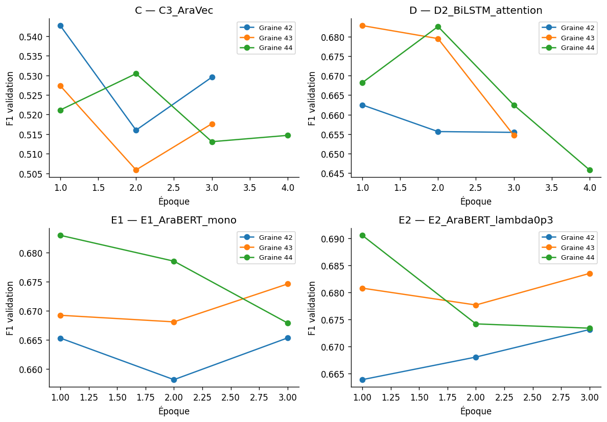
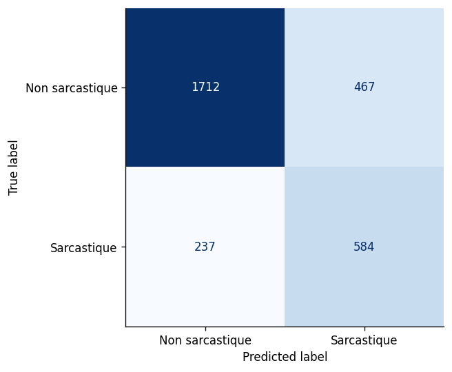
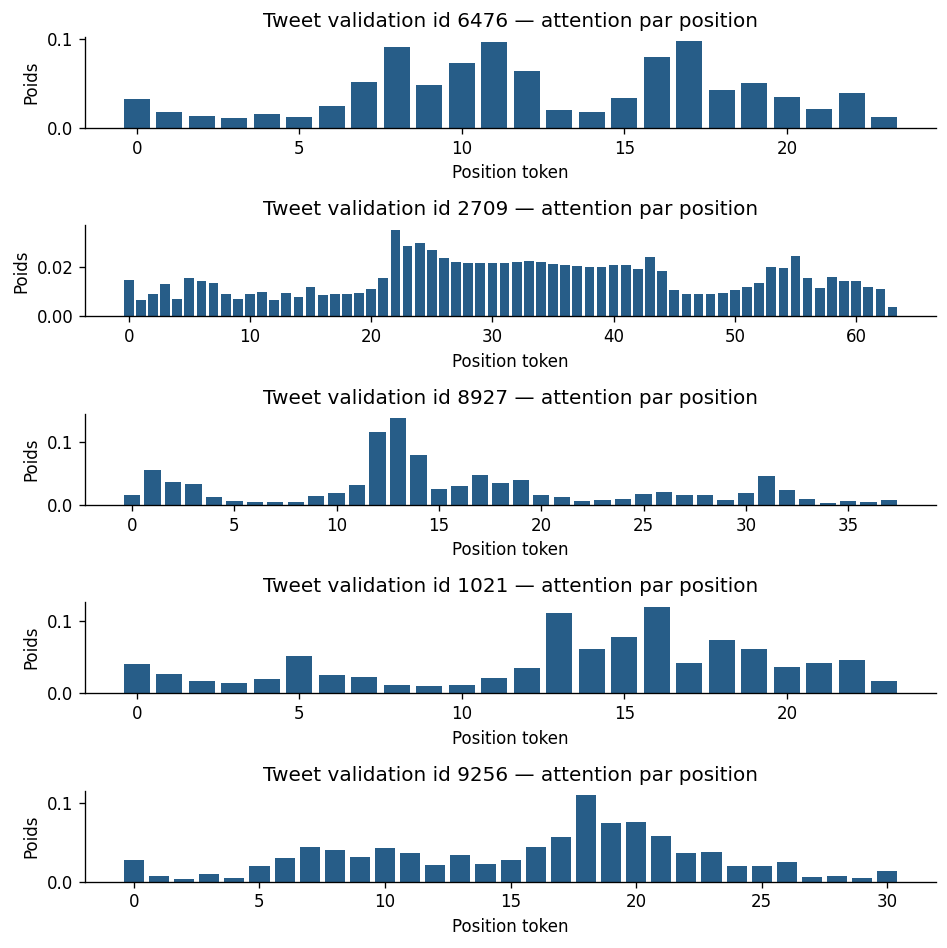

# TP2 - Détection du sarcasme en arabe

TP2 - Détection du sarcasme en arabe

Travail individuel - Omar Elkhali

Filière : BDIOT | Module : Transformers & LLMs | Prof. Yassir Matrane

Compte rendu du 18 octobre 2026 - Corpus ArSarcasm-v2

Dépôt public : https://github.com/OmarElkhali/TP2-ArSarcasm-v2

Objectif et provenance des résultats

J'étudie la détection du sarcasme dans des tweets arabes, du TF-IDF au fine-tuning multi-tâche. Ce rapport exploite les sorties de l'exécution T4 archivée (104/104 cellules, aucune erreur enregistrée) et les essais du testeur transmis en capture. Les expériences A à G ont été exécutées dans cette version ; leurs limites et les livrables encore manquants sont explicités page 6.

L'exécution mesurée utilise trois époques PLM maximum, dans la plage de 3 à 5 du sujet. Le code courant propose cinq époques ; ses nouveaux résultats ne sont pas encore enregistrés et ne sont pas revendiqués ici. Les résultats CPU antérieurs restent séparés en annexe C.

Q1 - Données, déséquilibre et métrique retenue

```csv
Partition,Effectif,Sarcasme / remarque
Train officiel,12548,"2 168 positifs ; 17,28 %"
Train initial / nettoyé,11 293 / 10 842,"1 864 positifs ; 17,19 %"
Validation,1255,"217 positifs ; 17,29 %"
Test officiel,3000,"821 positifs ; 27,37 %"
```

```csv
Dialecte,Train nettoyé : n ; taux,Val : n ; taux,Test : n ; taux
egypt,"2 320 ; 35,09 %","260 ; 36,15 %","306 ; 50,65 %"
gulf,"511 ; 22,90 %","68 ; 20,59 %","322 ; 17,70 %"
levant,"549 ; 21,68 %","55 ; 29,09 %","47 ; 29,79 %"
magreb,"35 ; 37,14 %",5 ; 0 %,2 ; 0 %
msa,"7 427 ; 10,79 %","867 ; 10,73 %","2 323 ; 25,61 %"
```

Le modèle « jamais sarcastique » a une accuracy de 82,71 % sur val et 72,63 % sur test, mais un F1 sarcastique nul. Je retiens le F1 de la classe sarcastique : F1 = 2PR/(P+R). Macro-F1 et average precision (AP, convention PR-AUC utilisée ici) complètent l'analyse.

Q2 - Audit des fuites et des raccourcis

Split stratifié 90/10, graine 42, avant ajustement. L'audit trouve 2 collisions train/test normalisées, 72 train/val, 331 lignes dupliquées et 47 groupes contradictoires (96 lignes). Ces ensembles se recouvrent : leur somme n'est pas le nombre de lignes retirées. Seul train est réduit à 10 842 ; val et test sont conservés. Les seuils et modèles sont choisis sur val, avant ouverture des labels test en F.

Dans train nettoyé : sarcasme avec URL 6,29 %, sans URL 23,90 % ; avec guillemets d'export 11,93 %, sans 25,33 %. Une règle superficielle peut produire un score non nul sans comprendre l'ironie.

Prétraitement et modèles sans fine-tuning

Q2 - Valeur des règles simples sur validation

```csv
Indice (absence → sarcasme),F1 val,Précision,Rappel
url,0.361768,0.232804,0.81106
mention,0.266439,0.163522,0.718894
artefact_guillemets,0.300578,0.218947,0.479263
```

Ces règles restent inférieures au TF-IDF, mais révèlent un risque de raccourci de provenance. Les guillemets extérieurs apparaissent dans 60,54 % du train brut contre 0,20 % du texte test ; leur suppression est un nettoyage d'export, pas une suppression générale de la ponctuation.

Q3 - Nettoyage selon la famille et ablation chiffrée

A/C : Unicode NFC, décodage HTML, retrait d'une paire de guillemets extérieurs, diacritiques et tatweel, normalisation alif/ya, URL et mentions remplacées par jetons. Je conserve négations, hashtags, emojis, rires, répétitions et ponctuation. AraVec clean_str sert à la recherche du vecteur. AraBERT emploie son préprocesseur officiel avec conservation des répétitions ; MARBERT reçoit un nettoyage minimal.

```csv
TF-IDF mots 1-2 + caractères 2-5,F1 val,AP val
A_tfidf_conservateur,0.520607,0.514514
A_tfidf_agressif,0.495935,0.490162
A_tfidf_standard,0.519481,0.517236
A_tfidf_sur_echantillonne,0.474308,0.476991
```

Le nettoyage agressif fait passer le F1 de 0,5206 à 0,4959 (-2,47 points). Il détruit des signaux utiles et n'est pas retenu. Le vocabulaire et le TF-IDF sont ajustés sur train uniquement. La régression logistique utilise balanced pour la pondération des classes et un seuil optimisé sur val.

Q4 - Zero-shot NLI : sensibilité à la formulation

```csv
Modèle / hypothèse,Précision val,Rappel val,F1 val,AP val
B1_NLI_ar,0.309353,0.59447,0.40694,0.346567
B1_NLI_fr,0.308026,0.654378,0.418879,0.349859
B1_NLI_en,0.329049,0.589862,0.422442,0.348801
B2_negatif_sarcastique,0.332692,0.797235,0.469471,0.474604
```

L'anglais obtient 0,4224, le français 0,4189 et l'arabe 0,4069 sur val : le prompt compte (+1,55 point entre arabe et anglais). B1 anglais atteint 0,4625 sur test, AP 0,4077. Le modèle NLI pré-entraîné compare une prémisse (tweet) à des hypothèses sarcastique/sérieuse sans apprendre sur nos exemples. L'auto-attention relie les tokens des deux segments ; le seuil est choisi sur val.

Q5 - « Négatif implique sarcastique » : un raccourci limité

B2 prédit sarcastique si l'argmax sentiment est negative, sans seuil optimisé sur P(negative). Sur val : précision 0,3327, rappel 0,7972, F1 0,4695 ; sur test : F1 0,5320 et AP 0,4928. Dans train, 90,45 % des sarcastiques sont NEG, mais seulement 41,89 % des NEG sont sarcastiques : une plainte sincère peut être négative, une louange ironique paraître positive.

Contamination B2 possible : CAMeLBERT sentiment a été entraîné sur ASTD/ArSAS/SemEval, et ArSarcasm-v1 réannote notamment ASTD/SemEval. Ce score n'est pas une preuve de généralisation sans recouvrement.

Réseaux statiques et représentations gelées

Q6 - Trois traitements du déséquilibre, meilleur C

```csv
Configuration,"F1 seuil 0,5",F1 seuil val,Seuil val
C3_AraVec_seed42,0.503165,0.542694,0.615209
C_meilleur_oversample_seed42,0.498516,0.54102,0.812528
C_meilleur_standard_seed42,0.439628,0.534653,0.293901
```

Perte pondérée : 0,5427 ; sur-échantillonnage : 0,5410 ; perte standard avec seuil optimisé : 0,5347. Le seuil apporte +3,95 points au meilleur C par rapport à 0,5. Les écarts entre méthodes sont faibles à cette graine. Le sur-échantillonnage reste limité au train après split : le faire avant pourrait placer des copies du même tweet en train et val.

Q7 - Architectures, embeddings et position

```csv
Architecture (graine 42),F1 val
C1_BiLSTM,0.477444
C2_attention,0.468271
C3_Transformer,0.462687
C3_sans_position,0.461864
C1_AraVec,0.529
C2_AraVec,0.5362
C3_AraVec,0.542694
```

C1 : BiLSTM avec max-pooling masqué. C2 : BiLSTM et attention apprise, alpha = softmax(vT tanh(Wh)), puis somme pondérée. C3 : deux couches Transformer, dimension 128, quatre têtes, positions sinusoïdales, masque PAD. Sans positions, C3 aléatoire passe de 0,4627 à 0,4619 : effet faible sur ce run, pas une preuve d'inutilité. C4 char-CNN et focal loss sont optionnels et non exécutés.

Budget C commun : huit époques maximum, patience 2 ; AraVec Twitter 100D figé deux époques puis dégelé. Le meilleur checkpoint peut précéder le dégel (C3 : époque 1). Vocabulaire : fréquence train ≥ 2, PAD distinct de UNK. OOV tokens train/val/test : 15,19 % / 21,16 % / 27,71 %. AraVec couvre 94,13 % des types du vocabulaire et 71,94 % des tokens train ; les dénominateurs diffèrent.

Q8 - D1/D2 : extraction gelée et coût réel

```csv
Encodeur AraBERT gelé,F1 val 42,Temps tête,Paramètres tête
D1 - CLS + régression logistique,0.6054,"4,7 s",769
D1 - moyenne masquée + régression,0.6316,"7,3 s",769
D2 - tokens + BiLSTM / attention,0.6625,"12,7 s",435 586
```

La moyenne masquée surpasse CLS de 2,62 points ; D2 gagne encore 3,09 points. Ces temps excluent extraction préalable, téléchargements et chargement des poids : ils ne représentent pas le coût total. L'encodeur reste nécessaire à l'inférence ; son cache évite des extractions répétées pendant la comparaison des têtes.

Les cinq attentions D2 (annexe D) ne portent pas seulement sur les marqueurs : le premier tweet donne environ 0,0964 à un point et 0,0904 à un sous-mot lexical. D'autres maxima concernent des mots de contenu. Une forte pondération n'est ni preuve de compréhension de l'ironie ni explication causale.

Fine-tuning et comparaison qualité / coût

Q8 et Q9 - Mono-tâche, sentiment auxiliaire et PLM

E1 ajuste tout l'encodeur par entropie croisée sarcasme pondérée. E2 partage l'encodeur et utilise deux têtes linéaires : L = Lsarc + lambda Lsent. Grille lambda {0,3 ; 0,5 ; 1} à graine 42, puis répétition du meilleur lambda et de E1 aux graines 43/44 pour chaque PLM. Le sentiment est une cible auxiliaire ; le dialecte n'est pas une entrée du classifieur.

```csv
PLM,E1 : F1 val (3 graines),E2 : F1 val (3 graines),Lambda retenu
AraBERT,0.6743 ± 0.0088,0.6824 ± 0.0088,0p3
MARBERT,0.6730 ± 0.0133,0.6703 ± 0.0125,0p5
```

```csv
"E2, graine 42","lambda 0,3","lambda 0,5",lambda 1
AraBERT,0.673114,0.671785,0.671845
MARBERT,0.660754,0.666667,0.662577
```

AraBERT multi-tâche a le meilleur F1 moyen val (0,6824). Le gain E2/E1 est +0,81 point val mais seulement +0,03 point test moyen (0,6096 contre 0,6093) : aucune amélioration nette sur test n'est démontrée. MARBERT E1 a un F1 val moyen proche (0,6730), son E2 lambda 0,5 est inférieur (0,6703). Le sentiment peut régulariser l'encodeur, mais aussi privilégier la négativité ou créer un transfert négatif.

Réglages mesurés : AdamW, lr 2e-5, weight decay 0,01, warmup 10 %, batch 32, AMP FP16, trois époques maximum, patience 2, longueur 64. Aucun sous-échantillonnage pour accélérer. Troncature train > 64 : 76 tweets AraBERT (0,70 %) et 35 MARBERT (0,32 %). E1 AraBERT entraîne 134 604 290 paramètres, E2 134 606 597 ; MARBERT environ 162,25 millions.

G - Comparaison finale, seuils verrouillés sur validation

```csv
Famille,F1 test moyen ± ET,AP test,Train (s),CPU ms/tweet,Poids (Mo)
A,0.5369 ± 0.0000,0.5349,5.7719,2.1534,5.8409
C,0.5402 ± 0.0078,0.5465,7.6708,2.4929,7.1405
D,0.5933 ± 0.0121,0.6254,13.8387,128.2663,542.81
E1,0.6093 ± 0.0221,0.6437,143.2107,117.8176,540.8659
E2,0.6096 ± 0.0131,0.6452,142.8676,116.6297,540.8769
B1,0.4625 (1 run),0.4077,0.0,407.5777,578.2752
B2,0.5320 (1 run),0.4928,0.0,123.4833,436.695
```

A = TF-IDF ; C = C3 AraVec ; D = D2 ; E1/E2 = AraBERT ; B1 = NLI anglais ; B2 = sentiment. A/C/D/E : trois graines ; B1/B2 : un passage sans entraînement sur le corpus. A est déterministe : ET nul attendu. Latences : CPU Colab, batch 1, médiane de trois passages après chauffe, vingt tweets. Elles ne mesurent pas le Ryzen local ni une latence de service en charge.

D2 → E1 : +1,60 point de F1 test moyen, environ 10,35 fois le temps d'ajustement de tête et 310 fois plus de paramètres entraînés. Les poids complets restent proches (environ 541 Mo), car D2 garde AraBERT. Ces temps excluent préparation et extractions ; ils ne permettent pas d'annoncer une durée totale.

Généralisation, robustesse et incertitude

Q10 - Décalage du prior et diagnostic des seuils

Le prior passe de 17,29 % val à 27,37 % test (+10,08 points). Ce changement et celui de composition affectent précision, rappel et F1. Le seuil déployable est celui de val ; les seuils test sont seulement des diagnostics a posteriori.

```csv
Famille,Seuil val,Seuil test posthoc,F1 seuil val,F1 posthoc
A,0.516072,0.458968,0.536913,0.551142
C,0.615209,0.570243,0.54476,0.552323
D,0.698322,0.572322,0.596187,0.633741
E1,0.520801,0.224268,0.624795,0.638743
E2,0.490785,0.298287,0.623932,0.638007
```

Pour E2, le seuil descend de 0,4908 à 0,2983 et le F1 diagnostic gagne 1,41 point ; ce n'est pas un réglage autorisé sur test. En production : suivi du prior, des dialectes et des scores ; annotation d'un nouveau lot temporel pour recalibrer ; contrôle sur un second lot indépendant.

Q11 - Dialecte non vu, URL et suppression des indices

Sans egypt, train passe à 8 522 exemples. Sur les 306 tweets egypt test, E2 passe de 0,7736 à 0,7674 : chute de 0,0063 (0,63 point). Le pré-entraînement peut déjà contenir de l'égyptien et l'architecture principale a été sélectionnée avec ce dialecte : cette faible chute ne démontre pas une indépendance au dialecte.

```csv
Famille,F1 sans URL,F1 avec URL,Réentraîné sans URL/mention,Chute détection sans indices
A,0.5437,0.076923,0.507514,9.38 points
C,0.55914,0.153846,0.543025,5.21 points
D,0.603529,0.193548,0.590565,6.59 points
E1,0.631813,0.242424,0.60274,5.77 points
E2,0.630092,0.258065,0.619943,4.62 points
```

Avec URL : 16 positifs sur 440 tweets ; sans URL : 805/2 560. Les F1 ne sont pas comparables à prior constant. Supprimer URL/mention à l'entraînement n'améliore aucune famille ici. F4 retire emojis, rires et ponctuation répétée aux vrais positifs initiaux, à seuil fixé : E2 garde 95,38 % des 584 détectés, contre 90,63 % des 480 de A. Ce test mesure une sensibilité, pas toute la compréhension.

Magreb : 35 tweets train et seulement 2 test, tous deux négatifs. Aucun F1 positif ni AP fiable ne peut soutenir un déploiement marocain. Il faut un test indépendant en darija, avec Arabizi, mélange français/arabe, nouveaux sujets et annotation relue.

Q12 - Incertitude et trente erreurs

Bootstrap, 1 000 rééchantillonnages, IC 95 % à graine 42 : A [0,5093 ; 0,5660], C [0,5172 ; 0,5729], D [0,5689 ; 0,6228], E1 [0,5997 ; 0,6487], E2 [0,5982 ; 0,6496]. McNemar exact E2/D : 151 erreurs gagnées, 156 perdues, p = 0,8195. La supériorité n'est pas significative selon ce test des erreurs appariées, qui ne teste pas directement le F1.

15 FN et 15 FP : catégories automatiques provisoires contexte/ironie implicite 19/30, dialecte-contexte 6/30, marqueur possiblement mal interprété 5/30. Aucun des trente n'a de clé contradictoire repérée ; cela ne démontre ni absence ni taux nul de bruit d'annotation. Une relecture contextuelle reste nécessaire : ces catégories ne sont pas une annotation humaine finalisée.

Essais sur phrases et conclusion personnelle

Du notebook scientifique à la saisie de phrases réelles

J'ai réalisé les expériences A à G prévues dans l'exécution T4 sauvegardée, avec les architectures demandées et les trois graines des modèles finaux. Cependant, lorsque j'ai saisi des phrases proches d'usages réels, je n'ai pas obtenu de bons résultats sur les exemples ironiques. Le respect d'un protocole et des scores positifs sur ArSarcasm-v2 ne garantissent donc pas une détection fiable en dehors de ce corpus.

Le testeur recharge checkpoint, prétraitement et seuil, puis utilise eval() et inference_mode(). La capture correspond à E2 AraBERT lambda 0,5, graine 42, seuil 0,579043. Ce n'est pas le checkpoint final lambda 0,3 au seuil 0,490785 de l'exécution archivée : ces évaluations ne doivent pas être fusionnées.

```csv
Sens des phrases arabes saisies,Lecture attendue,Score,Sortie observée
"Internet encore coupé, « service vraiment excellent » + emoji rieur",Ironie,"0,002247",Non sarcastique : manqué
"Il fait beau, je vais me promener.",Littéral,"0,001082",Non sarcastique : cohérent
"Merci des deux heures de retard, « vous respectez vraiment les gens »",Ironie,"0,015058",Non sarcastique : manqué
Je n'ai pas aimé ce film.,Critique littérale,"0,017326",Non sarcastique : cohérent
```

Le passage interactif de la phrase sur le retard donne 0,015073, toujours sous le seuil. Les deux exemples ironiques sont manqués ; les deux phrases littérales ont une sortie cohérente. Ces quatre phrases choisies à la main, sans annotation indépendante, ne permettent pas de publier un nouveau F1 ou une accuracy généralisable. Les originaux arabes et valeurs transcrites sont dans results/report_data/phrases_capture.csv.

Interprétation et décision de déploiement - Q12

Les exemples ironiques opposent une situation négative à une louange. Le modèle peut surtout exploiter des régularités lexicales, le sentiment et les indices du corpus sans résoudre ce contraste. Thèmes, formulations et dialectes changent ; le contexte manque. Un score n'est pas une garantie de probabilité calibrée. Abaisser le seuil pour réussir ces phrases reviendrait à ajuster le modèle sur la démonstration.

Je retiens E2 AraBERT lambda 0,3 comme candidat expérimental, choisi par le F1 moyen val : test 0,6096 ± 0,0131, environ 116,63 ms/tweet CPU Colab et 540,88 Mo. Le checkpoint représentatif graine 42 obtient précision 0,5557, rappel 0,7113, F1 0,6239, macro-F1 0,7267, AP 0,6355. Pour une contrainte CPU stricte, TF-IDF est un compromis : F1 0,5369, 2,15 ms, 5,84 Mo. Je ne validerais pas encore un déploiement automatique en darija ; je commencerais par un pilote avec contrôle humain et abstention, puis un test externe annoté.

Reproductibilité et limites des livrables

Le dépôt contient le notebook T4 exécuté, tous ses tableaux, le testeur, le code, les tests et ce rapport. Les 17 CSV individuels de prédictions test annoncés par Colab ne sont pas présents localement : il reste à les récupérer pour permettre un recalcul indépendant des métriques. Les agrégats ne les remplacent pas. Les poids volumineux ne sont pas publiés dans Git.

Les nouvelles cinq époques n'ont pas été exécutées par l'assistant. Les sorties du testeur viennent de la capture, leur provenance est explicite. Les anciennes mesures CPU ne sont pas des répétitions T4 supplémentaires. Graines fixées ne signifie pas déterminisme CUDA absolu. Ce bilan distingue réalisation des expériences, qualité réelle et pièces nécessaires à une remise entièrement vérifiable.

Annexe A - Courbes et matrice de confusion

Figures extraites de l'exécution T4, sans réentraînement. Courbes : F1 validation par époque sur trois graines. Matrice : checkpoint E2 lambda 0,3 graine 42, seuil val 0,490785.





Vrais négatifs 1 712 ; faux positifs 467 ; faux négatifs 237 ; vrais positifs 584. Total 3 000 ; 821 positifs réels. F1 = 1 168 / 1 872 = 0,623932.

Annexe B - Détail des runs T4

Scores affichés par le notebook. A/C/D/E1/E2 : graines 42/43/44 ; B1/B2 : un run. Le tableau G était arrondi à quatre décimales.

```csv
Modèle,Graine,Seuil val,F1 test,Macro-F1,AP test
A - TF-IDF,42,0.516072,0.536913,0.670166,0.534885
A - TF-IDF,43,0.516072,0.536913,0.670166,0.534885
A - TF-IDF,44,0.516072,0.536913,0.670166,0.534885
C3 - AraVec,42,0.615209,0.54476,0.672332,0.542786
C3 - AraVec,43,0.681563,0.544638,0.676206,0.541817
C3 - AraVec,44,0.676775,0.53121,0.682535,0.554771
D2 - BiLSTM attention,42,0.698322,0.596187,0.716224,0.629332
D2 - BiLSTM attention,43,0.733876,0.603708,0.721835,0.625056
D2 - BiLSTM attention,44,0.810747,0.579949,0.715155,0.621716
E1 - AraBERT mono,42,0.520801,0.624795,0.730004,0.631473
E1 - AraBERT mono,43,0.782746,0.583923,0.719183,0.653245
E1 - AraBERT mono,44,0.581184,0.619073,0.722828,0.646489
"E2 - AraBERT 0,3",42,0.490785,0.623932,0.726694,0.635503
"E2 - AraBERT 0,3",43,0.750975,0.598386,0.725486,0.65544
"E2 - AraBERT 0,3",44,0.624752,0.606494,0.717782,0.644577
B1 - NLI anglais,42,0.824869,0.462471,0.581689,0.407702
B2 - sentiment,42,0.5,0.532049,0.611444,0.49278
```

Grille E complète sur validation : trois époques par run

```csv
Modèle / lambda,Graine,F1 val,Train (s)
E1_AraBERT_mono,42,0.665331,147.761798
E2_AraBERT_lambda0p3,42,0.673114,158.065143
E2_AraBERT_lambda0p5,42,0.671785,232.698576
E2_AraBERT_lambda1p0,42,0.671845,231.360485
E1_AraBERT_mono,43,0.674584,149.197238
E1_AraBERT_mono,44,0.682927,132.673082
E2_AraBERT_lambda0p3,43,0.683486,136.541604
E2_AraBERT_lambda0p3,44,0.690526,133.996012
E1_MARBERT_mono,42,0.670968,158.330648
E2_MARBERT_lambda0p3,42,0.660754,154.621989
E2_MARBERT_lambda0p5,42,0.666667,147.238724
E2_MARBERT_lambda1p0,42,0.662577,149.546149
E1_MARBERT_mono,43,0.660907,163.452057
E1_MARBERT_mono,44,0.687243,146.569477
E2_MARBERT_lambda0p5,43,0.660099,165.169745
E2_MARBERT_lambda0p5,44,0.684211,151.994541
```

Tous les tableaux, dont 15 IC bootstrap individuels, 35 sous-groupes et les 30 erreurs, sont dans results/report_data/cell_*.csv. Les temps AraVec et D1 page 3 proviennent des journaux arrondis du notebook.

Annexe C - Historique CPU et traçabilité

Validation historique CPU, graine 42, même train nettoyé. Ces 24 lignes ne sont pas des résultats test ni une moyenne multi-graines. Les différences avec T4 sont conservées sans remplacer les sorties originales.

```csv
Modèle historique CPU,F1 val,AP val,Temps (s)
A_tfidf_conservateur,0.5206073752711496,0.5140675370653779,4.680464099998062
A_tfidf_agressif,0.4968944099378882,0.489753841976334,4.024494400000549
A_tfidf_standard,0.521551724137931,0.51695710097358,4.466853099998843
A_tfidf_sur_echantillonne,0.4743083003952569,0.4761306376735612,7.28275190000204
B1_NLI_ar,0.4069400630914827,0.3465674914058879,0.0
B1_NLI_fr,0.4188790560471976,0.3498629994575392,0.0
B1_NLI_en,0.4224422442244224,0.3488009284154478,0.0
B2_negatif_sarcastique,0.4694708276797829,0.4746041439289288,0.0
C1_BiLSTM,0.4534606205250596,0.4351786068369303,65.12501580000026
C2_attention,0.4647619047619047,0.4427406737107969,57.52761499999906
C3_Transformer,0.4726477024070022,0.4269088671809662,146.23993780000092
C3_sans_position,0.4627766599597585,0.4251675361580582,113.74004969999804
C1_AraVec,0.5369649805447471,0.5192832278293411,47.41351500000019
C2_AraVec,0.5285412262156448,0.5214974380742851,53.10222010000143
C3_AraVec,0.532608695652174,0.4976365456928686,48.418932000000495
C_meilleur_oversample,0.5338078291814946,0.5117232795188753,61.15428769999926
C_meilleur_standard,0.519163763066202,0.5274908032745778,59.05465399999957
D1_cls,0.605427974947808,0.6089550449931085,5.3760167000000365
D1_mean,0.631578947368421,0.6301094474314795,10.250370900001144
D2_BiLSTM_attention,0.6773547094188377,0.6912533346252046,164.9658591999978
E1_AraBERT_mono,0.6723404255319149,0.6751075634550345,4054.158946600001
E2_AraBERT_lambda0p3,0.676056338028169,0.6930373504306638,4056.2910748
E2_AraBERT_lambda0p5,0.6787330316742082,0.7007569530586353,5177.430744099998
E2_AraBERT_lambda1p0,0.6796116504854369,0.7069092237845941,3332.2248502
```

Sources et reproduction

Corpus : https://github.com/iabufarha/ArSarcasm-v2 ; AraVec : https://github.com/bakrianoo/aravec.

Modèles Hugging Face : aubmindlab/bert-base-arabertv02-twitter ; UBC-NLP/MARBERTv2 ; MoritzLaurer/mDeBERTa-v3-base-xnli-multilingual-nli-2mil7 ; CAMeL-Lab/bert-base-arabic-camelbert-da-sentiment. Révisions : models/revisions.json ; données : data/raw/manifest.json.

Régénérer le document : python -m src.report. Cette commande extrait les sorties enregistrées et compose le PDF ; elle ne charge aucun modèle et ne lance aucun entraînement. Tables HTML : pandas + lxml. Polices Arial, ReportLab. Corps : pages 1 à 6 ; annexes : pages 7 à 10.

Preuve : notebooks/TP2_Sarcasme_Arabe_T4_Execution.ipynb ; SHA256 et inventaire dans results/report_data/provenance.json. Le notebook de travail reste séparé pour préserver les résultats de cette exécution.

Annexe D - Attention et essais supplémentaires

D2 : cinq tweets sarcastiques de validation, poids par position extraits de l'exécution T4. Les tokens arabes et leur rendu droite à gauche figurent dans attention_5_tweets.html. Ces poids internes ne sont pas une attribution causale.



Contrôle local distinct du testeur Colab

Un diagnostic CPU antérieur sans entraînement a testé les quatre formulations avec un autre checkpoint E2 lambda 0,5, seuil 0,700477. Scores : 0,004811 ; 0,000933 ; 0,027889 ; 0,024360 ; toutes les sorties sont non sarcastiques. Ce n'est pas la répétition du checkpoint Colab au seuil 0,579043. Sur huit contrôles val choisis aux extrêmes (quatre positifs et quatre négatifs), le lecteur reproduit exactement les probabilités sauvegardées localement ; cela vérifie ce chargement, pas la qualité sur un nouvel échantillon représentatif.

Fichiers : results/phrase_inference_diagnostic.json et results/diagnostic_phrases.md. Le message de pooler BERT initialisé ne prouve pas à lui seul un chargement erroné : le classifieur utilise le CLS brut et le state_dict du checkpoint. La mauvaise généralisation est un constat ; sa cause technique exacte n'est pas démontrée.
